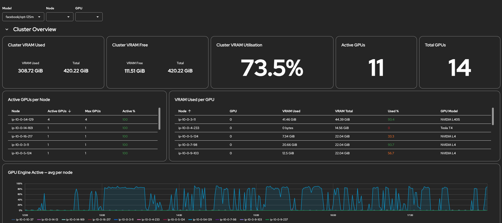

# NVIDIA GPU Utilisation

Outputs the NVIDIA GPU Utilisation at a Cluster, Model and GPU Level.

| | |
|---|---|
| **Purpose** | Gives an insight into GPU utilisation for the cluster, includuing which GPUs are assigned to where. |
| **Audience** | Infrastructure engineer, or model deployment engineer whose curious of cluster GPU capacity. |
| **Maintainer** | [@willsparker](https://github.com/willsparker) |
| **Format** | Perses: `perses.dev/v1alpha2`, Grafana: `grafana.integreatly.org/v1beta1` |

## Tested against

| Component | Version |
|---|---|
| OpenShift AI | 3.4 + 3.5 |
| Perses CRDs | via Cluster Observability Operator, `perses.dev/v1alpha2` |
| Grafana CRDs | via Grafana Operator, `grafana.integreatly.org/v1beta1` |
| vLLM | 0.24.x, 0.28.x |

## Required data

This dashboard uses:

  - NVIDIA DCGM Metrics (from the NVIDIA GPU Operator)
  - `vllm:*` metrics.

## Deploy

```bash
# Perses
oc apply -f dashboards/nvidia-gpu-utilisation/perses/

# Grafana
oc apply -f dashboards/nvidia-gpu-utilisation/grafana/
```

The namespace in the manifest matters: `PersesDatasource` is project-scoped, so
a dashboard outside `redhat-ods-monitoring` applies cleanly and then renders
empty with no error anywhere.

Remove it with:

```bash
# Perses
oc delete -f dashboards/nvidia-gpu-utilisation/perses/

# Grafana
oc delete -f dashboards/nvidia-gpu-utilisation/grafana/
```

## Known Limitations

- Several panels use 5 minute windows to smooth spikes. Bursts shorter than that won't register.

- This dashboard assumes that vLLM models are served and the primary users of the GPUs. Per-Model metrics rely on this data.

- For non-vLLM models (or non AI workloads), the "Other / Unattributed GPUs" section will show VRAM Usage and which pod uses which GPU.

## Screenshot


