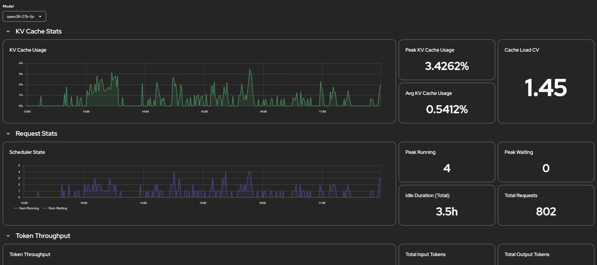

# vLLM Performance Monitor

This answers the question, what are the performance metrics of my vLLM served model, at a model scope.

This meant to be read by whomever deploys and maintains models for others to consume.

| | |
|---|---|
| **Purpose** | Give a general overview of vLLM model performance, metrics, including KV cache usage, token output, request loads. |
| **Audience** | Anyone operating model serving on this cluster. No admin rights needed. |
| **Maintainer** | [@willsparker](https://github.com/willsparker) |
| **Format** | Perses: `perses.dev/v1alpha2`, Grafana: `grafana.integreatly.org/v1beta1` |

## Tested against

| Component | Version |
|---|---|
| OpenShift AI | 3.4 + 3.5 |
| Perses CRDs | via Cluster Observability Operator, `perses.dev/v1alpha2` |
| Grafana CRDs | via Grafana Operator, `grafana.integreatly.org/v1beta1` |
| vLLM | 0.24.x, 0.28.x |

## Required data

This dashboard uses `vllm:*` data from Prometheus. Therefore, it only works with models served with vLLM.

## Deploy

```bash
# Perses
oc apply -f dashboards/vllm-performance-monitor/perses/

# Grafana
oc apply -f dashboards/vllm-performance-monitor/grafana/
```

The namespace in the manifest matters: `PersesDatasource` is project-scoped, so
a dashboard outside `redhat-ods-monitoring` applies cleanly and then renders
empty with no error anywhere.

Remove it with:

```bash
# Perses
oc delete -f dashboards/vllm-performance-monitor/perses/

# Grafana
oc delete -f dashboards/vllm-performance-monitor/grafana/
```

## Known Limitations

- Several panels use 5 minute windows to smooth spikes. Bursts shorter than that won't register.

## Screenshot



